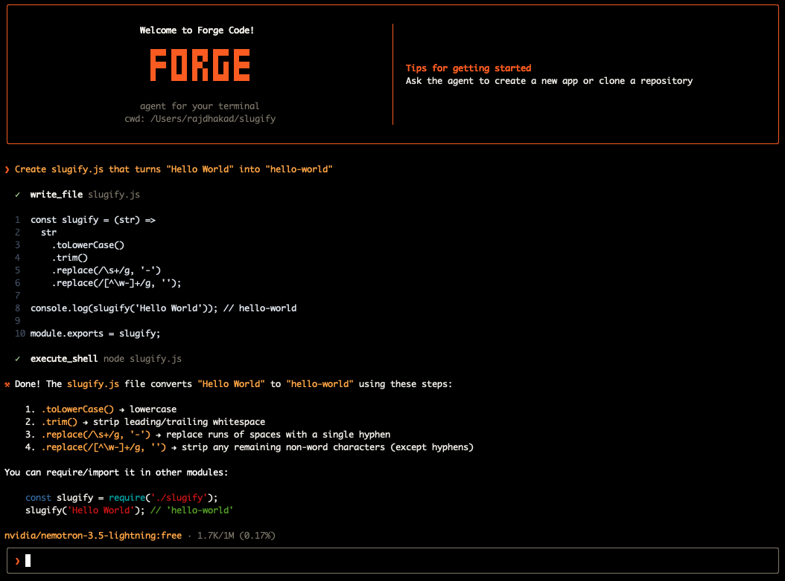
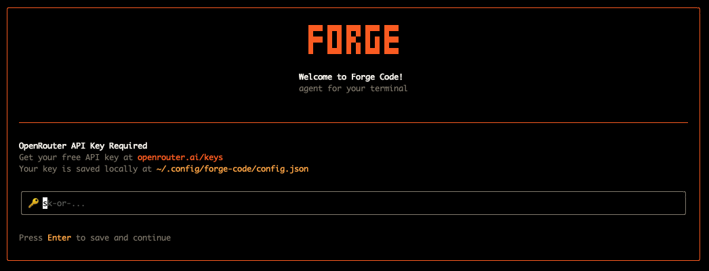

<div align="center">


**An AI coding agent for your terminal.**

[](https://www.typescriptlang.org/)
[](https://nodejs.org/)
[](https://openrouter.ai/)
[](LICENSE)

</div>



**Forge** is a terminal-native AI coding assistant that runs as an interactive agent in your shell. Point it at your codebase, describe what you want to build or fix, and Forge will read files, write code, run shell commands, and iterate — all from the comfort of your terminal.

It uses [OpenRouter](https://openrouter.ai/) to connect to any supported LLM (GPT-4o, Claude, Gemini, and more), and streams responses in real time with a clean Ink-rendered UI.


## Features

- **Agentic loop** — Forge runs tool calls iteratively until it has enough information to answer or complete a task
- **File system access** — reads, writes, lists, and edits files in your workspace
- **Shell execution** — runs arbitrary shell commands and returns output
- **Surgical edits** — targets exact strings in files for precise, safe modifications
- **Permission system** — tools like write, shell, edit require explicit approval before executing
- **Real-time streaming** — responses stream token-by-token as the model generates them
- **Context compaction** — automatically summarizes old conversation history to stay within model context limits
- **In-chat commands** — switch models, manage auth, and more without leaving the session
- **Flexible auth** — API key from environment variable or saved config file
- **Any OpenRouter model** — use any model available on OpenRouter, including free-tier ones

## Installation

### Prerequisites

- Node.js v22+
- An [OpenRouter](https://openrouter.ai/) API key

### Clone and install

```bash
git clone https://github.com/your-username/forge-code.git
cd forge-code
npm install
```

### Build and link globally

```bash
npm run build
npm link
```

This installs the `forge` binary globally so you can run it from anywhere.

## Getting Started

### 1. Launch Forge

```bash
forge
```

Or pass an initial prompt directly:

```bash
forge "Explain what this project does"
```

### 2. Authenticate

On first launch, Forge will prompt you for your OpenRouter API key if none is found.



Or use the in-chat command:

```
/auth login
```

### 3. Start chatting

Type your request and press **Enter**. Forge will reason, use tools, and respond — all in the terminal.

```
❯ Build me a REST API server in Express with a /health endpoint
```


## Usage

### Interactive mode

```bash
forge
# or
forge chat
```

### One-shot prompt

```bash
forge "What does the run.ts file do?"
```

## In-Chat Commands

| Command | Description |
|---|---|
| `/help` | Show all available commands |
|`/model` | Show the current model |
| `/model <name>` | Switch to a different model for this session |
| `/model <name> --save` | Switch model and save it as default |
| `/auth login` | Add or update your OpenRouter API key |
| `/auth logout` | Remove your saved API key |
| `/auth status` | Show current authentication state |
| `/quit` | Exit Forge |

The default model is openrouter/free. Resolution order is: /model override, then the saved config, then the default.

## Tools

| Tool | Permission required | Description |
| --- | --- | --- |
| `list_directory` | No | List the contents of a directory (non-recursive) |
| `read_file` | No | Read a file with line numbers, with optional `start_line` / `end_line`. Output is truncated at 10,000 characters |
| `get_current_time` | No | Current date and time in ISO 8601 |
| `write_file` | Yes | Create or overwrite a file |
| `edit_file` | Yes | Replace an exact string in a file; supports `replace_all` and preserves CRLF line endings |
| `execute_shell` | Yes | Run a shell command in the working directory and return stdout/stderr |

## Configuration

Forge stores its configuration at:

```
~/.config/forge-code/config.json
```

This file holds your saved API key and preferred model. You can manage these through the `/auth` and `/model` commands, or edit the file directly.

### Environment variables

| Variable | Description |
|---|---|
| `OPENROUTER_API_KEY` | Your OpenRouter API key (takes priority over saved config) |


## Architecture

```
src/
├── index.ts              # Entry point
├── cli/
│   ├── index.ts          # CLI setup (commander)
│   ├── chat.tsx          # Main interactive chat UI (Ink/React)
│   ├── PermissionPrompt.tsx
│   ├── ToolExecutionView.tsx
│   └── components/       # Reusable UI components
├── agent/
│   ├── run.ts            # Agentic loop (tool-call → execute → repeat)
│   ├── instructions.ts   # System prompt
│   ├── execute_tools.ts  # Tool dispatcher
│   └── permissions.ts    # Permission gate
├── commands/             # In-chat slash commands
├── config/               # Auth, model config, context window lookup
├── llm/                  # OpenRouter API client, streaming, types
└── tools/                # Tool implementations and registry
```

The **agentic loop** in `agent/run.ts` drives Forge's behaviour: it sends messages to the LLM, processes tool calls in sequence, asks for permissions where required, and feeds results back into the conversation until the model stops issuing tool calls.


## Development

```bash
# Run in development mode (no build step required)
npm run dev

# Type-check and build
npm run build

# Run the built binary
npm start
```

## Tech Stack

TypeScript, Node.js, Ink + React, Commander, the OpenAI SDK (Responses API) via OpenRouter, and marked with marked-terminal for markdown rendering.

## Contributing

Pull requests are welcome. For major changes, please open an issue first to discuss what you'd like to change.

1. Fork the repo
2. Create your branch (`git checkout -b feature/my-feature`)
3. Commit your changes (`git commit -m 'feat: add my feature'`)
4. Push to the branch (`git push origin feature/my-feature`)
5. Open a pull request

## License

[ISC](LICENSE)
